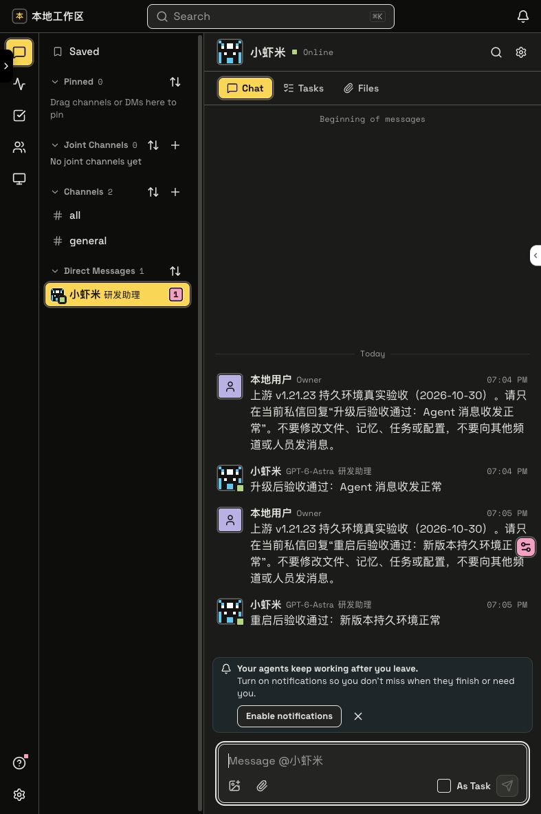

# 上游 v1.21.23 合并与持久环境验收

日期：2026 年 10 月 30 日，Asia/Shanghai。

上游版本：`v1.21.23-source.1`，提交 `db5e399f017d584e49597e3a28757645d6807893`。

## 本次升级方式

按用户决定，删除原 `raft-build` 本地环境后重建，没有迁移旧业务数据。原账号、机器和 Agent 身份均已替换；重建后创建了一个新的“小虾米”研发助理供日常使用。

选择重建的原因是上游重排了历史数据库迁移：旧库直接升级会跳过两条新增迁移，并在 `0273_session_token_predecessors` 因重复建表失败。本次没有修改上游迁移来兼容旧库；先在独立空库中验证全部 374 条迁移，再通过持久启动器完成正式初始化。

## 合并适配

- 合并 README 的新工具链要求与本地持久环境入口。
- 持久启动器沿用上游 OXC 执行器，最小初始化和空闲停止子进程使用同一执行方式。
- 同时保留上游应用端口检查和本地持久环境 HTTP 就绪检查。
- 保留命名数据卷、Redis AOF、最小初始化、凭据复用、启停锁、重复启动、失败保留数据、显式迁移和显式销毁机制。
- 将本地持久化测试迁移到 Vitest；启动拒绝测试允许只读检查数据卷，仍禁止写操作及重启。
- 补充公开快照缺少的根 Vitest 配置，保留 `RELEASE_SOURCE` 标记以区分未导出的私有 CI／部署契约。
- 清除锁文件中已不存在的 `apps/desktop`、`apps/feature-flag-admin` 工作区及其孤立依赖，验证冻结锁文件安装可复现。
- 本机使用 Node.js 24.22.1 和项目内独立安装的 pnpm 12.11.2。本机工具路径、数据和凭据均位于忽略目录，不进入 Git。

## 自动检查

| 检查 | 结果 |
| --- | --- |
| `pnpm install --frozen-lockfile --offline` | 通过 |
| `pnpm test:raftdev` | 10 个测试文件通过；133 项通过，10 项公开快照的私有文件契约按标记跳过 |
| `pnpm typecheck:raftdev` | 通过 |
| 服务端类型检查 | 通过 |
| Daemon 类型检查 | 通过 |
| 网页构建 | 类型检查、主包构建、产物检查及反馈页面构建全部通过 |

网页构建仍有上游已有的动态／静态导入混用和大文件包体提示，不影响本次构建通过。相对 upstream 的本地增量通过空白检查；全量合并保留了上游文件原有的行尾空格及文件末尾空行提示。

## 真实环境验收

1. 销毁原 `raft-build` 容器、三个命名数据卷、本机配置和 Agent 工作目录。
2. 重新 `start`，通过 374 条迁移初始化空库，只创建一个账号、一个工作区、一台机器、两个基础频道，没有导入演示数据。
3. 浏览器正常进入新工作区。通过人类账号的正常服务 API 创建本机 Codex Agent“小虾米”，模型为 `gpt-6-astra`，并创建私信。
4. Agent 实际回复：“升级后验收通过：Agent 消息收发正常”。
5. 重复 `start` 返回已在运行，没有重新初始化。记录业务数据指纹、凭据文件内容指纹及修改时间，写入独立 Redis 和 RustFS 验收标记。
6. 完整 `stop`，API、Web 两个端口均不可访问；随后对同一环境重新 `start`。
7. 重启后检查通过：账号、工作区、频道、机器、Agent 和首轮消息保留，凭据内容及修改时间未变，Redis 标记和 RustFS 原始内容一致，迁移总数仍为 374。
8. Agent 再次实际回复：“重启后验收通过：新版本持久环境正常”。浏览器可见完整两轮验收对话。
9. 清理独立存储标记，保留 4 条验收消息。结束时环境保持运行。

最终业务数据：1 个账号、1 个工作区、3 个频道（含私信）、1 台机器、1 个 Agent、4 条验收消息、0 个任务。

## 后续使用

网页入口：<http://localhost:15215/>。日常命令仍为 `./.slockdev/local-dev start raft-build`、`stop raft-build`、`restart raft-build` 和 `status`。

重建后恢复正常持久模式：日常启停保留新数据，不会重复建库或生成新机器身份。公网隧道和空闲自动停止保持关闭。本次只验收本机 Codex Agent，没有逐一验收其他运行环境及依赖外部服务的功能。

旧版本的验收见[历史验收记录](local-environment-acceptance-2026-10-30.md)，日常操作规则见[持久本地环境](local-persistent-environment.md)。
